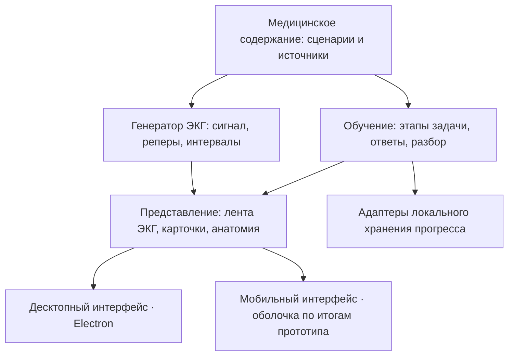

# Архитектура и развитие десктопной и мобильной версий

Дата решения: 22 ноября 2026 года. Документ фиксирует направление развития; независимое ядро и структура сценариев выделены; первый учебный случай и локальные попытки реализованы; подготовлены узкая мобильная компоновка, Android-прототип Capacitor 8 и офлайн-PWA для iPhone (с публикацией на GitHub Pages), которые проходят финальную проверку на устройствах. Текущая структура описана в [README](../README.md), генератор — в [CLINICAL_ENGINE.md](CLINICAL_ENGINE.md).

## Направление

Сохраняем React и TypeScript. Первая целевая платформа — автономное десктопное приложение для Windows на Electron. Следующая — мобильное приложение с интерфейсом для телефона и общим медицинским ядром.

Веб-технологии служат основой интерфейса и графики. Десктопная версия устанавливается или запускается локально и работает без сервера. Основные учебные сценарии, ЭКГ и анатомия должны быть доступны без интернета и обязательной регистрации. Онлайн-ссылки на источники требуют подключения.

| Решение | Статус |
| --- | --- |
| React / TypeScript, Canvas / SVG и Three.js | Используются; сохраняем |
| Electron для Windows | Используется; сохраняем на ближайших этапах |
| Общее медицинское ядро и структура сценариев | Реализованы в `src/core/`, включая учебные переходы первого случая |
| Отдельная компоновка для телефона | Реализована для первого случая; проверена в Chromium 390 px |
| Capacitor для упаковки Android | Android-проект подготовлен, debug APK собран; проверка обновлённого жеста на телефоне |
| Офлайн-PWA для iOS (Safari) | Реализована (`sw.js`, иконки, `safe-area`), задеплоена на GitHub Pages; проверка на iPhone |
| Tauri | Возможная альтернатива оболочки при измеримой необходимости |
| Локальное сохранение прогресса | Реализовано для первого случая, последние 20 попыток |
| Учётные записи и синхронизация | Возможный последующий этап; не являются условием обучения |

Первый технический мобильный прототип собран для Android; выбор приоритетных платформ на будущее остаётся открытым. Поддержка iOS, macOS и Linux не подтверждена сборками и проверками проекта.

## Границы модулей

Цель — использовать одни медицинские данные, расчёты и правила обучения на обеих платформах. Компоновку экранов, ввод мышью/касанием и доступ к локальному хранилищу адаптируем под платформу.

| Модуль | Ответственность | Ограничения зависимостей |
| --- | --- | --- |
| Медицинское содержание | Условия случая, ЭКГ-профили, находки КАГ, объяснения, ссылки на разделы КР | Не зависит от React, Electron и координат 3D-модели |
| Генератор ЭКГ | Сигнал в мВ, временные реперы, измерения и стадийные модификаторы | Не зависит от DOM, Canvas, файловой системы и оболочки |
| Логика обучения | Последовательность раскрытия данных, оценка ответа, разбор, повторение | Не управляет элементами интерфейса напрямую |
| Представление | Отрисовка ЭКГ, 3D и карточек, работа с масштабом и вводом | Получает готовые данные и вызывает команды учебной логики |
| Платформенные адаптеры | Чтение/запись прогресса, экспорт, внешние ссылки и жизненный цикл приложения | Детали Electron или мобильной оболочки не попадают в медицинские расчёты |

Это границы ответственности, а не требование немедленно создавать монорепозиторий или несколько пакетов. Сначала выделяем модули внутри существующего проекта. Пакеты понадобятся, когда появятся реальные независимые точки сборки.

Состояние интерфейса разделено между `src/App.tsx` (маршрутизация режимов, история `pushState` и ленивая загрузка `AtlasView`), `src/components/AtlasView.tsx` (состояние 3D-атласа и локализатора) и `src/components/TrainingPanel.tsx` (учебные этапы). Медицинские профили находятся в `src/core/content/coronaryCases.ts`, генератор и локализатор — в `src/core/ecg/`, типы — в `src/core/types.ts`. Привязки к геометрии отделены в `src/presentation/heartLandmarks.ts`; настройки проекций остаются вне ядра. Существующие инварианты синхронизации и генератора сохранены.

## Структура учебного случая

Контракт `ClinicalCaseScenario` в `src/core/scenarios/types.ts` задаёт клиническую ситуацию. Он предусматривает:

- Стабильный идентификатор и версию случая, учебные цели и необходимые исходные знания.
- Возраст, пол, жалобы, время от начала симптомов, анамнез, гемодинамику и другие значимые обстоятельства.
- Доступные исследования и порядок их раскрытия: исходная/повторная ЭКГ, дополнительные отведения, тропонин, ЭхоКГ, КАГ.
- Вопросы, допустимые ответы, основания оценки и разбор ошибок. При неоднозначности — допустимые альтернативы и пределы выводов.
- Источники: документ, редакция, раздел и условия применимости каждого тактического правила; статус медицинской проверки случая.

Диагноз, находка КАГ и иллюстрация анатомии могут быть скрыты до ответа. Вывод о срочности помощи учитывает клинические условия и риск, заданные случаем. Медицинская основа остаётся прежней: российские КР 2024 года по ИМпST и ОКСбпST из `ref/gudelines/`; учебные допущения обозначаются отдельно.

## Интерфейсы платформ

Десктопный атлас сохраняет возможность одновременно сопоставлять ЭКГ, анатомию, КАГ и пояснения. Режим обучения добавляет последовательное раскрытие информации и скрытый диагноз.

На телефоне основной маршрут: **задача → ЭКГ → ответ → разбор → анатомия/КАГ**. ЭКГ получает отдельный экран с масштабированием, выбором отведений и измерениями. 3D открывается по необходимости, чтобы освободить экран и ограничить нагрузку на устройство.

Повторно используем компоненты там, где сохраняются удобство и точность. Жесты калипера, панорамирования и зума разрабатываем для касания отдельно; уменьшение десктопных колонок само по себе не считается мобильным интерфейсом. Широкая лента ЭКГ должна оставаться измеримой при прокрутке и масштабировании.

Прогресс сначала сохраняем локально: результаты попыток, типы ошибок, отметки ЭКГ и проекцию КАГ. Формат хранения имеет версию и проверяет структуру доказательств при восстановлении. При появлении синхронизации локальное обучение продолжает работать без сети.

## Этапы и критерии готовности

| Этап | Результат | Критерий готовности |
| --- | --- | --- |
| 1. Выделение ядра | Разделены медицинские данные, расчёты, учебные переходы и представление | Ядро запускается в тестах без React/DOM/Electron; действующий атлас сохраняет поведение |
| 2. Один законченный десктопный кейс | Жалобы → ЭКГ → решение → разбор, с локальным сохранением попытки | Диагноз не раскрывается раньше ответа; оценка объяснима и связана с источниками; прогресс переживает перезапуск |
| 3. Мобильный прототип того же кейса | Отдельные экраны и управление касанием; пробная упаковка | Проверен на реальном целевом телефоне; основные функции работают без интернета; ЭКГ читается и измеряется |
| 4. Выбор мобильной оболочки | Решение по результатам измерений прототипа | Проверены запуск, масштаб и калипер, восстановление после сворачивания, локальное хранение, 3D и работа без сети |
| 5. Расширение содержания | Новые случаи, повторение ошибок, реальные записи | Добавление случая преимущественно меняет данные; у случая есть источники и статус проверки; обе версии проходят регрессионные проверки |

Новые мимики, сложная проводимость, реальные записи ЭКГ и уточнение 3D-анатомии остаются направлениями развития. Их добавление согласуем с архитектурными этапами и медицинской проверкой; расширение каталога не заменяет проверку мобильного прототипа.

## Когда пересматривать технологический выбор

Electron сохраняем, пока измерения на целевых компьютерах подтверждают приемлемые запуск, память и работу графики. Переход на Tauri рассматриваем при конкретной проблеме размера или потребления ресурсов, после проверки WebGL, Canvas, ресурсов и локального хранения в системных WebView.

Capacitor проверяем первым кандидатом для мобильной упаковки существующего React-интерфейса. Если прототип выявит ограничения, влияющие на учебные задачи, сравниваем альтернативы по тем же сценариям. Полную переделку на Flutter или React Native оцениваем только при подтверждённой необходимости и с учётом стоимости переноса графики и интерфейса.

Официальные сведения об оболочках: [Electron](https://www.electronjs.org/docs/latest/), [Tauri](https://v2.tauri.app/start/), [Capacitor](https://capacitorjs.com/docs). Совместимость конкретного приложения подтверждается проверками на устройствах.

## Проверки при реализации

- Генератор: `npm run test:ecg`; локализатор: `npm run test:clinical`.
- Типы и сборка: `npx tsc --noEmit`, `npm run build`; для изменений веб-части — `npm run dist:win`.
- Интерфейс: проверка сценариев, измерений и графики на целевой платформе; десктопная проверка через Chromium не заменяет мобильную.
- Медицинская проверка: отдельно от программных тестов. Согласованность генератора с собственными параметрами не доказывает клиническую достоверность всех форм ЭКГ.

## Реализованная основа от 22.11.2026

- Публичный интерфейс — `src/core/index.ts`. Ядро состоит из TypeScript-модулей без внешних импортов и работает в Node.js без браузера. Отдельная конфигурация `tsconfig.core.json` проверяет его без DOM и платформенных глобальных типов.
- `ATLAS_SCENARIOS` описывает все 16 существующих примеров: стабильный id, версия схемы, редакция, цели, допущения, ссылки и статус `partially-reviewed`. Профили сигнала не дублируются. Заголовки выбора сценариев в приложении берутся из этого каталога.
- Тип `ClinicalCaseScenario` задаёт пациента, последовательность информационных/ЭКГ/диагностических этапов, вопросы с допустимыми вариантами и итоговый разбор. Реализован первый клинический случай, фиксация ответов, последовательное раскрытие данных и локальное хранение попыток; см. [TRAINING.md](TRAINING.md).
- `validateScenario()` проверяет связность типизированных авторских данных: ссылки на профили/источники, идентификаторы этапов, варианты ответа и основные диапазоны. Функция не предназначена для безопасного импорта произвольного JSON и не подтверждает медицинскую корректность.
- Прежние пути модулей сохранены как реэкспорты совместимости; интерфейс переведён на прямые импорты ядра. Тип `CoronaryCase` больше не содержит `landmark`.
- Проверки: `npm run test:core` (включает отдельную компиляцию и контроль границ), `npm run test:ecg`, `npm run test:clinical`. Сравнение до/после переноса подтвердило идентичность медицинских данных, 15 привязок 3D, контрольных результатов локализатора и хеша сигналов по всем сценариям, стадиям и типам кровоснабжения в проверенной матрице.

Первый авторский клинический случай и логика его прохождения реализованы. Следующие проверки — врачебная рецензия содержания и мобильный прототип того же случая. Контракт ещё может уточняться по результатам этого случая; при несовместимом изменении формата нужно повышать `schemaVersion`, при изменении содержания — `revision`.

## Состояние мобильного прототипа

Подготовлена узкая веб-компоновка первого случая: разделы этапа, прокручиваемая ЭКГ, крупные кнопки, тап по сегментам Bullseye и калипер с касанием. Проверка Chromium 390 px прошла; описание — [TRAINING.md](TRAINING.md).

3D-атлас вынесен в ленивый чанк (`AtlasView`), а pinch-to-zoom на ленте ЭКГ использует CSS `transform` во время жеста с перерисовкой на `touchend` и ограничением `dpr ≤ 2`.

Добавлен проект `android/` на Capacitor 8.6.2, конфигурация локальных ресурсов, обработка системной кнопки «Назад» (`OnBackPressedCallback` + `window.history`) и команды `android:sync`, `android:apk`, `android:open`. В мобильной оболочке и установленной PWA первым открывается учебный режим. Подробности — [ANDROID_BUILD.md](ANDROID_BUILD.md).

Для iPhone подготовлена офлайн-PWA: иконки `apple-touch-icon.png` / `192` / `512` / `maskable`, безопасные отступы `safe-area-inset-*`, подавление жеста масштабирования страницы в Safari, автогенерация Service Worker (`sw.js`) в `vite.config.ts` и автоматический деплой на GitHub Pages через `.github/workflows/deploy-pages.yml`. Подробности — [IOS_PWA.md](IOS_PWA.md). Этап 3 остаётся открытым до завершения полевых проверок на физических Android и iPhone устройствах.
